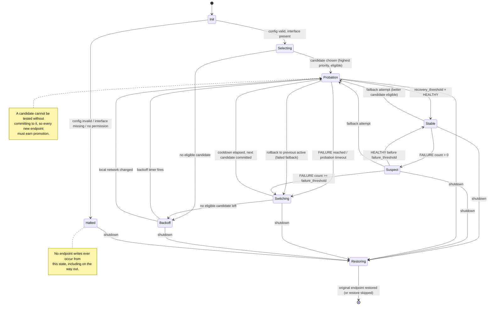

# Health monitoring and failover design

This is the core of the project. Everything else is plumbing around it.

The design is constrained by three facts that are easy to get wrong:

1. WireGuard is silent when idle, so an old handshake proves nothing
   ([upstream §6](../research/upstream-analysis.md#6-an-idle-tunnel-is-not-a-broken-tunnel)).
2. A UDP endpoint cannot be tested by a generic UDP probe — there is nothing to probe.
3. We hold no private key, so we cannot construct a handshake initiation ourselves.

Together these force a specific design: **commit, stimulate, observe, and roll back** — rather
than probe-then-switch.

---

## 1. The four layers of "connectivity"

The word "connectivity" hides four different questions with four different answers. Conflating
them is the most common failure in this problem space.

| Layer | Question | Observable? | How |
|---|---|---|---|
| **L0 — Name** | Does the hostname resolve? | Yes | DNS query |
| **L1 — Endpoint reachability** | Is anything listening at `ip:port`? | **No, not reliably** | see §2 |
| **L2 — WireGuard handshake** | Does the peer complete a Noise handshake? | Yes | `last_handshake` advances after stimulus |
| **L3 — Tunnel connectivity** | Do packets traverse the tunnel and return? | Yes | probe to an in-tunnel target; `rx_bytes` increases |
| **L4 — Application connectivity** | Does the service behind the tunnel respond? | Yes | TCP/HTTP probe to an application endpoint |

**Only L2 and above are decisive for failover.** L0 is a precondition. L1 is not measurable
and must never be used as a failure criterion.

An important asymmetry: **L2 success is stronger evidence than it looks.** A completed
handshake proves the peer received our initiation *and* we received its response — a full
round trip in both directions, authenticated with the correct keys. It does not prove that
the peer will forward our traffic (its `AllowedIPs` might not cover the target), but it does
prove the endpoint is alive and is the peer we think it is.

**L3 is the only signal that proves the data plane works.** L4 adds assurance that the
peer's onward routing works, which matters when the peer is a gateway.

## 2. Why an independent UDP prober is not possible

The intuitive design — "ping each candidate endpoint, then switch to a live one" — cannot be
built. Three independent reasons:

### 2.1 UDP has no reachability primitive

There is no connection, no SYN, no acknowledgement. A UDP datagram to a closed port may
produce an ICMP port-unreachable, or may be silently dropped by any firewall on the path. A
UDP datagram to an open port produces nothing at all unless the application replies. Absence
of a response means "down, or filtered, or rate-limited, or the reply took a different path".
It cannot distinguish these.

A generic UDP probe to `51820` therefore tests **nothing**. WireGuard only replies to a
correctly formed, correctly encrypted handshake initiation. Anything else is discarded
silently — that silence is a deliberate design property.

### 2.2 A valid initiation requires the peer's private key

A WireGuard handshake initiation is constructed from the sender's ephemeral key, the sender's
**static private key**, and the receiver's static public key:

```go
handshake.precomputedStaticStatic, _ = device.staticIdentity.privateKey.sharedSecret(pk)
```

Source: [`wireguard-go/device/peer.go`](https://github.com/WireGuard/wireguard-go/blob/master/device/peer.go).

An external prober that wants a real handshake response would need the private key. That
directly violates the project's primary security invariant. It is not a trade-off to be
weighed; it is a hard stop.

### 2.3 The port is owned by the implementation

Even with the key, the listen port belongs to the kernel module or the userspace device. A
second socket sending initiations from a different port would elicit responses to *that*
port, and the responses would be useless — they would not advance the peer's state, and the
index/cookie state would not match. Sending from the real port is impossible while the
implementation holds it.

### 2.4 Consequence

> **You cannot test a candidate endpoint without committing to it.**

This single sentence determines the switching algorithm. There is no "check, then switch".
There is only "switch, then verify, then roll back if wrong". That is why the state machine
has a `Probation` state and why failback is an *attempt* rather than a measurement.

It also means the cost of a wrong failback attempt is a brief interruption. Mitigations:
keep the attempt short (`probe_timeout`), and roll back immediately on failure.

## 3. Stimulus: how to make WireGuard speak

Since observation alone is insufficient, every active check begins with a stimulus. Three
modes, in descending order of signal quality:

### 3.1 `target` mode (default when targets are configured)

Send one probe packet to an address covered by the peer's `AllowedIPs`, so the host's routing
sends it into the tunnel. ICMP echo by default; TCP SYN to a configured port optionally.

```text
send ICMP echo -> 10.0.0.1        (routed via wg0 because AllowedIPs covers it)
  |
  +-- no valid session -> WireGuard initiates a handshake
  +-- valid session     -> packet is encrypted and sent
```

Effects:

- Forces a handshake when the session is missing or expired.
- Produces `rx_bytes` growth when the target replies (L3).
- Produces a `last_handshake` advance when a handshake was needed (L2).

**Do not require the target to be reachable.** A target that drops ICMP still produces an L2
signal, because the handshake happens regardless of whether the payload is answered. This is
why a single configured target is enough even if it does not respond to everything.

### 3.2 `keepalive` mode (default when no target is configured)

Temporarily set `persistent_keepalive_interval` on the peer to a value slightly above
`check_interval` (minimum 10 s, the protocol's `KeepaliveTimeout`). A keepalive is an
authenticated packet; if no session exists, sending it triggers a handshake.

This **modifies a peer setting**, which the project otherwise forbids. Therefore:

- the original value is recorded before the first write and restored on clean shutdown;
- the change is logged at `info` with before/after values;
- the change is visible in `status` output;
- it can be disabled with `probe.allow_keepalive = false`.

This is the only peer attribute besides `endpoint` that the engine may ever write, and it is
opt-in by configuration. See [security.md §4.6](security.md#46-peer-attribute-write-surface).

### 3.3 `passive` mode (explicit opt-in only)

No stimulus. Existing traffic is treated as implicit evidence.

Honest limitation: **passive mode cannot detect a dead endpoint on an idle tunnel.** If
nothing is sent, nothing is learned. It reports `UNKNOWN`, not `HEALTHY`, and it will not
fail over until real traffic exists. It is provided for environments where injecting probe
traffic is unacceptable, and the documentation must say plainly that it degrades to
"failover on first user-visible failure".

## 4. Evaluation algorithm

One check cycle, executed every `check_interval`:

```text
evaluate(peer, now) -> Result

  if local_network_changed_recently(now):
      return LOCAL_NETWORK_DOWN          # never count as endpoint failure

  s0 = Read(iface, peer)                 # observed endpoint, handshake, counters
  if s0.InterfaceUp == false:
      return LOCAL_ERROR                 # do not fail over; surface the error

  session_age  = now - s0.LastHandshake
  session_live = session_age < REJECT_AFTER_TIME      # 180s, protocol constant

  stimulus(s0)                           # §3, according to probe mode
  sleep(probe_timeout)                   # default 3s
  s1 = Read(iface, peer)

  handshake_advanced = s1.LastHandshake > s0.LastHandshake
  rx_advanced        = s1.ReceiveBytes  > s0.ReceiveBytes

  if handshake_advanced:
      return HEALTHY                     # L2 proven: full round trip, correct keys
  if rx_advanced:
      return HEALTHY                     # L3 proven: data plane works

  # Nothing came back. Distinguish "cannot tell yet" from "proven dead".
  if session_live:
      return INCONCLUSIVE                # keys still valid; a dead path is not yet provable
  return FAILURE                         # session expired and no new handshake
```

### Why `INCONCLUSIVE` exists

If the transport session is still valid (< 180 s since the last handshake), a broken path and
a peer that simply does not answer our probe look identical. Declaring `FAILURE` here would
produce false failovers on every network that filters ICMP — the exact flapping behaviour the
project is required to avoid.

So the engine waits. This is not timidity; it is the protocol's own guarantee:
`RejectAfterTime = 180 s` is the point past which the peer cannot communicate at all without
a new handshake. Failure is *provable* only after that.

`INCONCLUSIVE` resets the consecutive-failure counter only if it persists. Concretely: an
`INCONCLUSIVE` streak longer than `max_inconclusive_cycles` (default: enough to exceed
`RejectAfterTime`, i.e. `ceil(180s / check_interval)`) escalates to `FAILURE`. This is a
safety net for clocks and counters misbehaving, not the primary mechanism.

### Why `LOCAL_ERROR` never triggers failover

If the interface is down, the daemon lacks permission, or the device disappeared, switching
endpoints cannot help and would destroy evidence. These are surfaced as errors and the engine
holds its current endpoint.

## 5. Detection latency bounds

| Probe mode | Worst-case detection | Typical | Notes |
|---|---|---|---|
| `target` | `failure_threshold × check_interval + probe_timeout` | 15–20 s at defaults | Bounded by our own parameters |
| `keepalive` | `REJECT_AFTER_TIME + failure_threshold × check_interval` | ≤ 195 s at defaults | Bounded by the protocol, not by us |
| `passive` | unbounded | — | Cannot detect an idle dead endpoint |

This table is the honest answer to "how fast is failover?" and belongs in user documentation.
Promising sub-second failover is not possible without breaking the no-private-key invariant.

**Design consequence:** `target` mode is strongly recommended and should be the documented
default for production. `keepalive` is the fallback. `passive` is a last resort.

## 6. Switching policy

### 6.1 Candidate ordering

Candidates are ordered by `priority` (ascending; lower number = more preferred). Ties are
broken by configuration order, so ordering is deterministic and reproducible.

### 6.2 Hysteresis

Two independent thresholds, deliberately not symmetric:

| Parameter | Default | Purpose |
|---|---|---|
| `failure_threshold` | 3 | Consecutive `FAILURE` results before switching |
| `recovery_threshold` | 3 | Consecutive `HEALTHY` results before a candidate is trusted |

Asymmetry matters: `recovery_threshold` applies to a *new* endpoint in `Probation`, so a
candidate that completes one handshake and then dies does not get promoted. In `Probation`,
the candidate must pass `recovery_threshold` consecutive cycles before `Stable`.

### 6.3 Cooldown and anti-flap

| Parameter | Default | Purpose |
|---|---|---|
| `min_switch_interval` | 10 s | Hard floor between endpoint writes |
| `candidate_backoff_base` | 30 s | First backoff after a candidate fails |
| `candidate_backoff_max` | 900 s | Ceiling |
| `candidate_backoff_factor` | 2.0 | Exponential growth |
| `backoff_jitter` | 0.2 | ±20 % randomisation, prevents synchronised retries |
| `max_switches_per_hour` | 12 | Global safety valve; exceeding it stops automatic switching and requires operator action |

Backoff is **per candidate**, not global. A candidate that just failed is skipped for its
backoff period; other candidates remain eligible. This prevents a single dead endpoint from
slowing down recovery via a healthy one.

`max_switches_per_hour` is the anti-oscillation backstop. If a configuration is genuinely
ambiguous (two endpoints that are both intermittently healthy), the engine will hit this
limit, stop switching, and report a `FLAPPING` condition rather than burning the link. That
is a deliberate fail-safe.

### 6.4 Failback

`failback = true` (default) means: when the active endpoint is not the most-preferred
*eligible* candidate, periodically attempt a return.

```text
on failback_timer:
    if active == preferred_eligible: return
    if now < last_failback_attempt + failback_interval: return
    target = highest-priority candidate that is not active and not in backoff
    if target is none: return
    switch to target, enter Probation
    if Probation fails:
        revert to previous active endpoint immediately
        target.backoff *= factor        # do not retry this candidate soon
        last_failback_attempt = now
```

Defaults: `failback_interval = 60 s`, growing to `candidate_backoff_max` on repeated failure
of the same candidate.

Because a candidate cannot be tested without committing (§2.4), **failback is an attempt, not
a measurement**. It is therefore always guarded by:

- cooldown since the last switch,
- the candidate's own backoff,
- immediate rollback on probation failure,
- the global switch rate limit.

Users who prefer stability over preference can set `failback = false`, which pins the tunnel
to whatever endpoint is currently working. This should be documented as a legitimate choice,
not a degraded mode.

### 6.5 DNS re-resolution

Resolution is owned by the `dns` component, not by WireGuard
([upstream §3](../research/upstream-analysis.md#3-endpoints-are-always-stored-as-resolved-ipport)).

| Behaviour | Rule |
|---|---|
| Refresh interval | `dns_refresh_interval`, default 60 s; also on TTL expiry when the resolver provides it |
| Multiple A/AAAA | All addresses of one hostname are *sub-candidates* of the same logical endpoint |
| Ordering within a hostname | `family` policy: `auto` prefers the family that last worked, then both, interleaved |
| Address fails | Try the next sub-candidate before declaring the logical endpoint down |
| Resolution fails | Candidate becomes `UNRESOLVED`; **not** counted as an endpoint failure |
| Resolution fails but a last-known-good address exists | Continue using it for up to `dns_stale_max` (default 300 s), logging staleness |
| Malformed / SERVFAIL / timeout | Treated as `UNRESOLVED`; never crash, never treat as endpoint down |
| No resolver reachable | `UNRESOLVED` for all hostname candidates; IP-literal candidates keep working |

The `UNRESOLVED` distinction is important: a DNS outage is not evidence that the endpoint is
dead, and failing over because of it would move the tunnel for the wrong reason.

### 6.6 IPv4 and IPv6

- Both families are first-class candidates. A candidate's family is explicit
  (`family = "ipv4" | "ipv6" | "auto"`), because an operator may want to avoid a family
  entirely.
- `auto` prefers the family of the currently working endpoint (stability over novelty), then
  falls back to trying the other family.
- Handshake success on IPv6 proves IPv6 reachability; the engine never infers cross-family
  reachability.
- The engine does **not** implement happy-eyeballs racing. Racing would mean committing to
  two endpoints in quick succession, which violates `min_switch_interval` and produces
  exactly the oscillation this design forbids.

### 6.7 When every endpoint fails

Enter `Backoff`:

- keep the current endpoint (do **not** tear down the tunnel, do **not** restore the original
  — a dead tunnel is better than a destroyed interface);
- rotate through all candidates with per-candidate exponential backoff and jitter;
- keep the daemon running and log at `error` once per rotation cycle, not once per attempt;
- expose `state = BACKOFF` and `all_candidates_failed = true` in status;
- optionally invoke `on_all_failed` hook (a command), which is a documented escape hatch for
  operators who want to restart the interface or alert;
- resume normal operation the moment any candidate passes probation.

There is no "give up permanently" state. Recovery must be automatic when the network returns.

## 7. Local network changes

A Wi-Fi ↔ cellular transition, a VPN interface flap, or a default route change breaks every
endpoint simultaneously. Counting those as endpoint failures causes pointless failover churn
and, worse, may move the tunnel to a candidate that is also unreachable.

Detection per platform:

| Platform | Mechanism |
|---|---|
| Linux | rtnetlink: `RTMGRP_LINK`, `RTMGRP_IPV4_ROUTE`, `RTMGRP_IPV6_ROUTE` |
| Windows | `NotifyIpInterfaceChange`, `NotifyRouteChange2` (via `winipcfg`) |
| Android | `ConnectivityManager.NetworkCallback` |

On a local network change:

1. reset all consecutive-failure counters,
2. start a grace period (`network_grace`, default `2 × check_interval`) during which failures
   are recorded as `INCONCLUSIVE`,
3. force an immediate re-evaluation at the end of the grace period,
4. re-resolve DNS immediately (the resolver configuration may have changed).

This is why `LOCAL_NETWORK_DOWN` is a distinct result and not a failure.

## 8. State machine



Diagram source: [`design/diagrams/failover-state-machine.mmd`](../../design/diagrams/failover-state-machine.mmd).

### State definitions

| State | Meaning | Writes endpoint? |
|---|---|---|
| `Init` | Load config, validate, read interface, record the original endpoint | no |
| `Selecting` | No active endpoint yet; choose the best eligible candidate | no |
| `Probation` | A candidate has been committed and is being confirmed | yes (on entry) |
| `Stable` | Confirmed healthy on the active endpoint | no |
| `Suspect` | Failures accumulating, below threshold | no |
| `Switching` | Transition; enforces cooldown before the next write | yes (on entry) |
| `Backoff` | All candidates failed or ineligible; retrying with backoff | no |
| `Restoring` | Shutdown path; restores the recorded original endpoint | yes (if configured) |
| `Halted` | Unrecoverable local condition; no further writes | no |

### Transition guards

Every transition into `Probation` or `Switching` is guarded by:

```text
now - last_switch_time >= min_switch_interval
AND switches_this_hour < max_switches_per_hour
AND target.backoff_until <= now
```

If a guard fails, the engine stays in the current state and re-evaluates on the next tick.
Guards are evaluated in one place, so they cannot be bypassed by a new code path.

## 9. Concurrency and safety

- **Single writer.** All endpoint writes go through one serialised `apply()` function guarded
  by a mutex and a monotonically increasing `generation` counter. A write whose generation is
  stale is discarded, so a slow DNS lookup cannot overwrite a newer decision.
- **No write during a write.** The manager holds the lock across "write + re-read", so a
  check cycle cannot observe a half-applied state.
- **Idempotent.** Writing the endpoint that is already set is a no-op that does not increment
  the switch counter. This matters because roaming may have already moved us there.
- **Crash safety.** See [failure-modes.md](failure-modes.md#3-daemon-crash-and-restart).

## 10. What this design deliberately does not do

| Not done | Why |
|---|---|
| Independent UDP probing of candidates | Impossible without the private key (§2) |
| Racing two endpoints simultaneously | Requires two writes in quick succession; violates cooldown; causes oscillation |
| Treating handshake age as health | Produces false failovers on idle tunnels (§4) |
| Tearing down and rebuilding the tunnel | The entire point is to avoid this |
| Inferring L3 from L2 | A handshake proves the peer is alive, not that it forwards our traffic |
| Detecting failure faster than `RejectAfterTime` without a target | Not possible; the protocol hides the evidence (§5) |
| Automatic endpoint discovery | Out of scope; candidates are operator-supplied |
