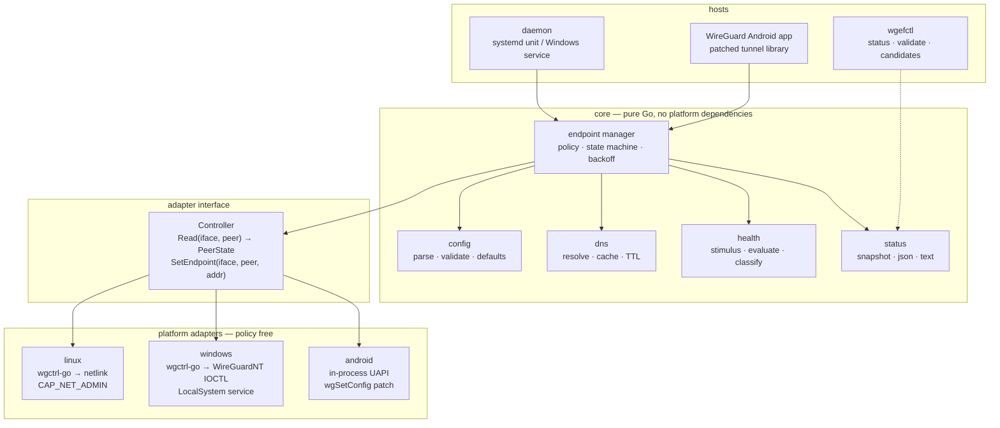

# Architecture overview

## 1. Constraints that shape the design

Derived from research, not preference:

| # | Constraint | Source |
|---|---|---|
| C1 | A peer has exactly one endpoint; alternatives must live outside WireGuard | [upstream §1](../research/upstream-analysis.md#1-a-peer-has-exactly-one-endpoint) |
| C2 | An endpoint write is a peer-scoped partial update; it never needs a restart | [upstream §4](../research/upstream-analysis.md#4-updating-an-endpoint-is-peer-scoped-and-non-destructive) |
| C3 | Roaming can overwrite our write at any time | [upstream §5](../research/upstream-analysis.md#5-roaming-silently-overwrites-a-manually-set-endpoint) |
| C4 | An idle tunnel is healthy; handshake age alone is not a failure signal | [upstream §6](../research/upstream-analysis.md#6-an-idle-tunnel-is-not-a-broken-tunnel) |
| C5 | Endpoints are stored resolved; DNS is our responsibility | [upstream §3](../research/upstream-analysis.md#3-endpoints-are-always-stored-as-resolved-ipport) |
| C6 | Linux and Windows are controllable from a privileged external process; Android is not | [platform §4](../research/platform-capabilities.md#4-cross-platform-conclusion) |
| C7 | No private key may be handled, so no independent handshake prober is possible | [health §2](health-monitoring.md#2-why-an-independent-udp-prober-is-not-possible) |

C6 is the one that decides the architecture. C7 is the one that decides the health model.

## 2. The three options

### Option A — Shared Go engine with platform-specific adapters

One Go module. A platform-agnostic core (policy, state machine, DNS cache, configuration,
status) plus an adapter that implements a small interface per platform.

```text
core (pure Go, no platform deps)
   |-- LinuxAdapter   -> wgctrl-go -> netlink
   |-- WindowsAdapter -> wgctrl-go -> WireGuardNT IOCTL
   `-- AndroidAdapter -> (see Option C) in-process UAPI
```

### Option B — Platform-native implementations

Go on Linux and Windows, Kotlin on Android, with a shared *specification* and a shared
conformance test suite but no shared code.

### Option C — Shared core with native bindings

A shared core exposed to platform integrations, for example a Go core built with `gomobile
bind` into an AAR consumed by Kotlin, or a Go core built as a `c-shared` library and driven
through JNI.

## 3. Evaluation

Scored against the criteria the project cares about. "Cost" means total cost of ownership
over the life of the project, not initial effort.

| Criterion | A: shared engine | B: native per platform | C: shared core + bindings |
|---|---|---|---|
| **Maintainability** | One implementation of the hard part (hysteresis, backoff, reconciliation). Three thin adapters. | Three implementations of the hard part. The state machine is where divergence causes outages. | One implementation, plus a binding layer that must be maintained per platform. |
| **Platform compatibility** | Strong on Linux and Windows: `wgctrl-go` provides the *same* `ConfigureDevice` call on both ([platform §1–2](../research/platform-capabilities.md)). Android needs an in-process adapter regardless of option. | Strongest on Android (native Kotlin against a patched library), no Go runtime in the app. | Strong, provided the binding can run inside the app process — which is required on Android anyway. |
| **Packaging** | One binary per platform. Linux `.deb`, Windows MSI with a service. Android unaffected (the engine ships inside the app either way). | Linux/Windows Go binaries; Android normal Gradle. No cross-language build. | Adds `gomobile`/NDK to the Android build. Note the Android build **already** compiles Go (`libwg-go.so`), so a Go toolchain is not a new dependency. |
| **Testing** | One test suite for the state machine, runnable on any OS. Adapter contract tests per platform. Linux integration tests in network namespaces. | Three test suites for the same behaviour. Conformance suite must be written twice (Go + Kotlin) or driven externally. | One core suite; binding tests per platform. |
| **Security** | One implementation to review for "does it ever touch a key?". Small trusted computing base. | Three implementations to audit for the same invariant. Higher chance one drifts. | One implementation to audit; binding layer adds an FFI boundary (memory safety, JNI lifecycle). |
| **Long-term** | Bounded: adapters are ~200–400 lines each and depend on stable upstream APIs. | Unbounded: every policy change is implemented three times, and three reviewers must agree. | Bounded core; binding layer is the risk (toolchain churn, ABI issues). |

### Evidence that Option A is viable on Windows

This was the pivotal question. `wgctrl-go` builds a **`wgwindows`** client on Windows that
enumerates WireGuardNT adapters through SetupAPI and issues `DeviceIoControl(IOCTL_SET)` with
`PeerHasEndpoint | PeerUpdateOnly` — the same flags the official `wireguard-windows` driver
package uses.

Sources: [`os_windows.go`](https://github.com/WireGuard/wgctrl-go/blob/master/os_windows.go),
[`internal/wgwindows/client_windows.go`](https://github.com/WireGuard/wgctrl-go/blob/master/internal/wgwindows/client_windows.go),
[`wireguard-windows/driver/configuration_windows.go`](https://github.com/WireGuard/wireguard-windows/blob/master/driver/configuration_windows.go).

So the Linux and Windows adapters are not merely *similar* — they are the same library call
against the same `wgtypes` model. Option A's claim to be the low-maintenance choice rests on
that fact, not on optimism.

### Why Option B is rejected as the primary architecture

Option B is honest about the platform split and would produce the best Android experience
with no Go in the app. But it duplicates exactly the code where a bug is most expensive: the
failure/recovery decision logic. Two implementations of hysteresis and backoff will diverge,
and the divergence will appear as "failover behaves differently on my phone", which is
expensive to diagnose and impossible to test centrally. The project's value is in the policy,
so the policy should exist once.

### Why Option C is rejected as the *general* architecture

Option C's benefit is code reuse across a language boundary. That benefit is real for
Android, where a boundary is unavoidable, and unnecessary on Linux and Windows, where Go runs
natively and a binding would add an FFI layer for no gain. Applying C everywhere would add
`gomobile`/cgo to two platforms that need neither.

## 4. Recommendation

**Option A, with Option C applied to Android only.**

Concretely:

- **One Go module** containing the platform-independent core.
- **Linux and Windows adapters** are thin wrappers over `wgctrl-go`. No cgo, no subprocesses,
  no `wg.exe`.
- **The Android adapter runs the same core inside the app process**, linked into the
  `tunnel` library's Go component, because Android forbids an external controller
  (C6). This is Option C's mechanism used where it is actually required.

This is not "maximise code reuse". It is: the platform-independent policy is written once
because duplicating it is the largest correctness risk; the platform-dependent parts are
written per platform because they are genuinely different; and Android gets the binding
treatment because the platform leaves no alternative.



Diagram source: [`design/diagrams/architecture-components.mmd`](../../design/diagrams/architecture-components.mmd).

## 5. Component responsibilities

| Component | Owns | Must never |
|---|---|---|
| `config` | Parsing, validation, defaults, error messages | Read the WireGuard config's private key |
| `dns` | Resolution, caching, TTL handling, multi-address policy | Cache indefinitely; assume a resolver is available |
| `health` | Stimulus, observation, classification, thresholds | Declare failure from an idle tunnel |
| `endpoint manager` | Candidate ordering, switching policy, hysteresis, backoff, reconciliation, restore-on-shutdown | Write anything other than `endpoint` |
| `status` | Read-only snapshot for CLI, logs, metrics | Expose key material or raw packet contents |
| adapters | Translate `Read`/`SetEndpoint` into platform calls | Contain policy |

Policy lives in the endpoint manager and health components. Adapters are deliberately dumb:
they translate, they do not decide. This is what keeps three adapters cheap.

## 6. Adapter interface

The only contract between core and platform:

```go
// Controller is the platform boundary. Implementations are thin and contain no policy.
type Controller interface {
	// Read returns a snapshot of one peer on one interface.
	Read(ctx context.Context, iface string, peer wgtypes.Key) (PeerState, error)

	// SetEndpoint writes exactly one attribute of one existing peer.
	// Implementations MUST NOT send any other attribute.
	SetEndpoint(ctx context.Context, iface string, peer wgtypes.Key, ep netip.AddrPort) error
}

// PeerState is the observation surface. Deliberately narrow.
type PeerState struct {
	Endpoint        netip.AddrPort // observed, may differ from desired (roaming)
	LastHandshake   time.Time
	ReceiveBytes    int64
	TransmitBytes   int64
	PersistentKeepalive time.Duration
	InterfaceUp     bool
}
```

Three properties are deliberate:

- **`SetEndpoint` takes a resolved address.** Resolution belongs to the `dns` component so it
  is testable without a platform (C5).
- **No method writes keys.** The interface makes the invariant structural: there is no
  function that *could* write a key.
- **`Read` returns the observed endpoint**, not the desired one, so roaming is visible (C3).

A `Watch`/event source for local network changes is per-platform and lives beside the
adapter, not in this interface — the core only needs to know "the local network changed,
re-evaluate now".

## 7. Proposed repository layout

Nothing below exists yet except `docs/`. This is the target shape for milestone 2.

```text
cmd/
  wg-endpoint-failover/      # daemon (linux, windows)
  wgefctl/                   # CLI: status, validate, list candidates
internal/
  config/                    # companion config: parse, validate, defaults
  engine/                    # endpoint manager: policy + state machine
  health/                    # stimulus, evaluation, classification
  dns/                       # resolver with cache and multi-address policy
  status/                    # snapshot types, rendering
  adapter/
    controller.go            # the interface above
    linux/                   # wgctrl-go netlink
    windows/                 # wgctrl-go WireGuardNT
    android/                 # in-process UAPI, built only for android
  netchange/                 # local network change detection
    netchange_linux.go
    netchange_windows.go
    netchange_android.go
test/
  integration/               # Linux netns + virtual wg interfaces
  conformance/               # behaviour spec tests, shared
android/                     # patch to wireguard-android tunnel lib + app integration
```

Directories are created when they contain something. No placeholder packages.

## 8. Request flow for one check cycle

```mermaid

sequenceDiagram
    autonumber
    participant T as ticker
    participant E as endpoint manager
    participant H as health
    participant D as dns
    participant C as Controller
    participant W as WireGuard

    T->>E: check interval elapsed

    E->>C: Read(iface, peer)
    C->>W: WG_CMD_GET_DEVICE
    W-->>C: endpoint, last_handshake, rx/tx
    C-->>E: PeerState

    E->>E: reconcile observed vs desired (roaming)

    alt local network changed recently
        E-->>T: LOCAL_NETWORK_DOWN — counters reset, no failover counted
    else interface missing or permission denied
        E-->>T: LOCAL_ERROR — Halted, no endpoint write
    else continue
        E->>H: evaluate(PeerState, stimulus needed?)
        H->>W: probe packet into tunnel (L3 target, or keepalive)
        H->>C: Read(iface, peer) after probe_timeout
        C-->>H: PeerState'
        H-->>E: HEALTHY | FAILURE | INCONCLUSIVE

        alt HEALTHY (handshake advanced, or rx advanced)
            E->>E: clear failure counter; confirm probation
        else INCONCLUSIVE (transport keys still valid)
            E->>E: record only; do not count toward failure_threshold
        else FAILURE
            E->>E: increment failure counter
            alt counter >= failure_threshold
                E->>D: resolve next eligible candidate
                D-->>E: ip:port (or UNRESOLVED)
                E->>E: apply() — cooldown, per-candidate backoff,<br/>rate limit, generation check
                E->>C: SetEndpoint(iface, peer, addr)
                C->>W: set=1 / WG_CMD_SET_DEVICE<br/>public_key + endpoint only (update-only)
                W-->>C: ok
                E->>E: enter Probation
            else counter below threshold
                E->>E: stay in Suspect
            end
        end
    end
```

Diagram source: [`design/diagrams/failover-sequence.mmd`](../../design/diagrams/failover-sequence.mmd).

## 9. Non-goals, restated as architecture decisions

- **No WireGuard fork.** Adapters use upstream APIs; no vendored patch to `wireguard-go`'s
  cryptography. The single Android patch adds a *configuration entry point*, not a protocol
  change.
- **No tunnel lifecycle management.** The MVP attaches to an existing interface. It does not
  create interfaces, set addresses, or manage routes. That keeps it composable with
  `wg-quick`, NetworkManager, and Windows' WireGuard service.
- **No key material.** Structurally enforced by the adapter interface.
- **No relay or broker.** Candidates are operator-supplied addresses.

## 10. Consequences to accept

1. **Three adapters, not one.** Accepted; they are small and policy-free.
2. **Android requires a patch to an upstream library.** Accepted, with the patch proposed
   upstream; the alternative (companion app) is impossible
   ([platform §3](../research/platform-capabilities.md#3-android)).
3. **The engine cannot prove an endpoint dead while its session keys are valid** unless a
   tunnel-level health target is configured. This is a property of the protocol, documented
   in [health-monitoring.md](health-monitoring.md#5-detection-latency-bounds).
4. **Windows requires a privileged service.** Unavoidable; the driver handle needs
   Administrators.
